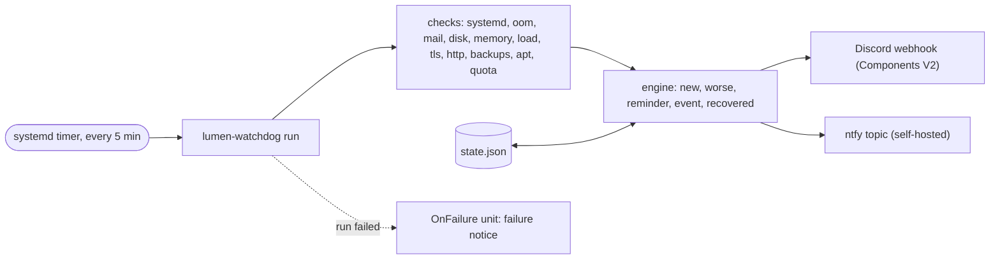

<!-- header:begin: brand-repos 0.1.0, variant studio, files in docs/brand/; the project-page sync drops this block -->
<picture>
  <source media="(prefers-color-scheme: dark)" srcset="docs/brand/readme-header-dark.svg">
  <source media="(prefers-color-scheme: light)" srcset="docs/brand/readme-header-light.svg">
  
</picture>

<!-- byline:studio -->
*a [Luminare Development](https://luminare.tech/open-source/lumen-watchdog/) open-source project*
<!-- /byline:studio -->
<!-- byline:personal
*by Paul Pasaurek · [project page](https://luminare.tech/open-source/lumen-watchdog/)*
/byline:personal -->

<!-- header:end -->

# Lumen Watchdog

A small health watchdog for Linux mail and web servers: it checks systemd units, the mail stack,
disks, memory, certificates, websites, backups, updates and quotas every few minutes and sends
alerts to Discord and to a self-hosted ntfy server.

[](https://github.com/luminare-dev/lumen-watchdog/actions/workflows/ci.yml)
[](LICENSE)
[](https://scorecard.dev/viewer/?uri=github.com/luminare-dev/lumen-watchdog)

## Why

A single server that runs web hosting, mail and a few side services fails in quiet ways: a mount
namespace error stops Dovecot and nobody notices for two days, the OOM killer takes out the virus
scanner again, a quota service fails after a kernel update, a certificate renewal breaks. Big
monitoring stacks are too heavy for a 4 GB host. lumen-watchdog is one Python program without
dependencies, one TOML file and a systemd timer; it remembers what it already reported, reminds
about open problems, says when they are fixed and keeps working when the host's namespaces do not.

## What it checks

| Check | What it looks at |
|---|---|
| `systemd` | every failed unit; a watch list of units that must be active (glob patterns such as `php8.*-fpm.service`); restarts by systemd since the last run |
| `oom` | "Killed process" lines in the kernel log since the last run |
| `mail` | Postfix queue size and age of the oldest message; IMAP, LMTP (Unix socket) and SMTP greetings; Rspamd `/ping` |
| `disk` | space and inodes per mounted file system |
| `memory` | available memory, swap use, memory pressure (PSI "full", 60 s) |
| `load` | 5-minute load per CPU |
| `tls` | certificate expiry and trust on the live endpoints (any port with direct TLS) |
| `http` | status code, expected text and latency of URLs |
| `backups` | age of the newest file in backup folders |
| `apt` | pending security updates and `reboot-required` |
| `quota` | user and group quotas switched on |

Each check has thresholds, can run less often than the timer (`every_minutes`) and has its own
repeat interval, cooldown and confirmation count. See [docs/configuration.md](docs/configuration.md).

## Alerts

- **Discord**: a webhook message with a custom name and avatar, built from Components V2: a
  container whose accent colour follows the severity, a header section with a thumbnail, grouped
  problem lines, a footer with the time in each reader's own time zone and link buttons (panel,
  webmail, status page). It mentions one user every time, and `allowed_mentions` permits only
  that user. Rate limits (HTTP 429) are honoured with `retry_after`.
- **ntfy**: one push per run to a private topic on a self-hosted ntfy server, priority and tags by
  severity, a click URL and up to three action buttons. [deploy/ntfy/](deploy/ntfy/) has a Docker
  Compose file bound to 127.0.0.1, a server configuration with `deny-all` default access, an
  Apache reverse-proxy snippet and a script for the two accounts (publisher token, read-only phone
  user). See [docs/ntfy.md](docs/ntfy.md).

One run sends at most one message per channel. A problem is sent when it first appears (after
`confirm_runs` failed runs), again when it gets worse, as a reminder every `repeat_minutes` while it
stays open, and once more when it recovers. Events (OOM kills, restarts) are sent each time they
happen. Secrets (webhook URL, user ID, ntfy token) come from the environment or a root-only
environment file, never from the configuration file, the command line or the logs.

## Quickstart

```bash
git clone https://github.com/luminare-dev/lumen-watchdog && cd lumen-watchdog
sudo ./install.sh                                   # program to /opt, example config to /etc
sudoedit /etc/lumen-watchdog/config.toml            # hosts, URLs, units, buttons
sudo lumen-watchdog run --dry-run                   # all checks now, payloads printed, nothing sent
sudo lumen-watchdog test --channel discord && sudo systemctl enable --now lumen-watchdog.timer
```

The secrets file and the ntfy server are described in [docs/install.md](docs/install.md).

## How it works



## Design decisions

The decisions behind this project are recorded as short ADRs in [docs/adr/](docs/adr/):

- [ADR 0001: Record architecture decisions](docs/adr/0001-record-architecture-decisions.md)
- [ADR 0002: Pin every action and downloaded tool](docs/adr/0002-pin-actions-and-downloaded-tools.md)
- [ADR 0003: Secret scanning with the gitleaks binary](docs/adr/0003-secret-scanning-with-the-gitleaks-binary.md)
- [ADR 0004: Draft releases with checksums and provenance](docs/adr/0004-draft-releases-with-checksums-and-provenance.md)
- [ADR 0005: Standard library only, one process per run](docs/adr/0005-standard-library-only.md)
- [ADR 0006: No mount-namespace sandbox for the service](docs/adr/0006-no-namespace-sandbox.md)
- [ADR 0007: Components V2 for Discord, JSON publish for ntfy](docs/adr/0007-message-formats.md)

**Alternatives.** Monit, Netdata, Uptime Kuma and Prometheus with Alertmanager all do parts of this
well, with more features and bigger footprints. lumen-watchdog stays a single file tree without
dependencies for one host where memory is short, and it knows the mail stack of a typical
KeyHelp-style server (Postfix queue, Dovecot LMTP socket, Rspamd).

## Supported versions

| Component | Tested with | Supported |
|---|---|---|
| Python | 3.12 (Ubuntu 24.04) | 3.11 or later (`tomllib`) |
| systemd | 255 | 245 or later (`journalctl -g`) |
| Postfix | 3.8 | 3.1 or later (`postqueue -j`) |
| ntfy server | 2.38.2 | 2.x |

Fixes go into the latest minor release only. See the
[security policy](https://github.com/luminare-dev/.github/blob/main/SECURITY.md) for reporting.

## Limitations

- One host per installation: it watches the machine it runs on (plus remote URLs and certificates).
- When the host is down, nothing is sent. Pair it with an outside uptime check for that case.
- `tls` checks ports with direct TLS only (443, 465, 993); STARTTLS ports are not covered.
- `apt` reads the package lists apt already has; it does not run `apt update`.
- The state file is local; a damaged file is replaced, and open problems are then sent again.

## Results

| What | Value | How it was measured |
|---|---|---|
| Unit tests | every check, the engine, both payloads | `python3 -m unittest discover -s tests -v` in CI |
| Run time | about 4 s for 11 checks, 16 certificates and 7 URLs | `run --dry-run` on a 3-CPU, 4 GB host, 2026-11-27 |
| Peak memory | about 30 MB for the Python process, about 120 MB for the `apt-get -s` child | same run, `getrusage` |

## Documentation and links

- [Installation](docs/install.md) · [Configuration](docs/configuration.md) · [ntfy server](docs/ntfy.md) ·
  [ADRs](docs/adr/)
- [Changelog](CHANGELOG.md) and [releases](https://github.com/luminare-dev/lumen-watchdog/releases)
  (each release has `SHA256SUMS` and a build provenance attestation)
- [Contributing](https://github.com/luminare-dev/.github/blob/main/CONTRIBUTING.md) ·
  [Code of conduct](https://github.com/luminare-dev/.github/blob/main/CODE_OF_CONDUCT.md) ·
  [Security](https://github.com/luminare-dev/.github/blob/main/SECURITY.md) ·
  [Support](https://github.com/luminare-dev/.github/blob/main/SUPPORT.md)
- Project page: <https://luminare.tech/open-source/lumen-watchdog/>

## Licence

[Apache-2.0](LICENSE). The licence covers the code only: the project name, logo, header images
and `docs/brand/` are not licensed (see [NOTICE](NOTICE)).

<!-- byline:studio -->
*a [Luminare Development](https://luminare.tech/open-source/lumen-watchdog/) open-source project*
<!-- /byline:studio -->
<!-- byline:personal
*by Paul Pasaurek · [project page](https://luminare.tech/open-source/lumen-watchdog/)*
/byline:personal -->
